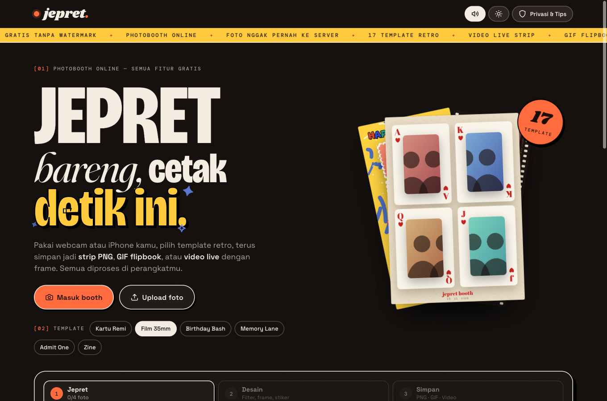
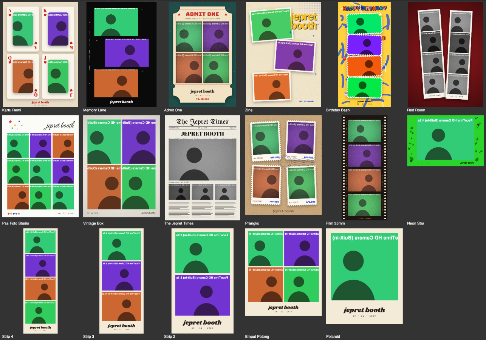
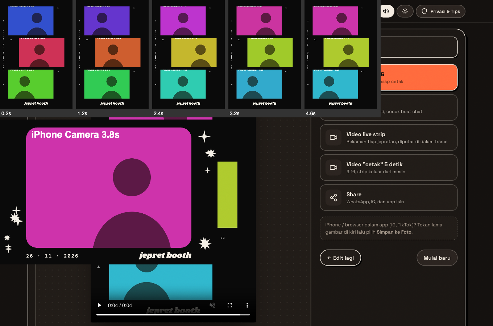
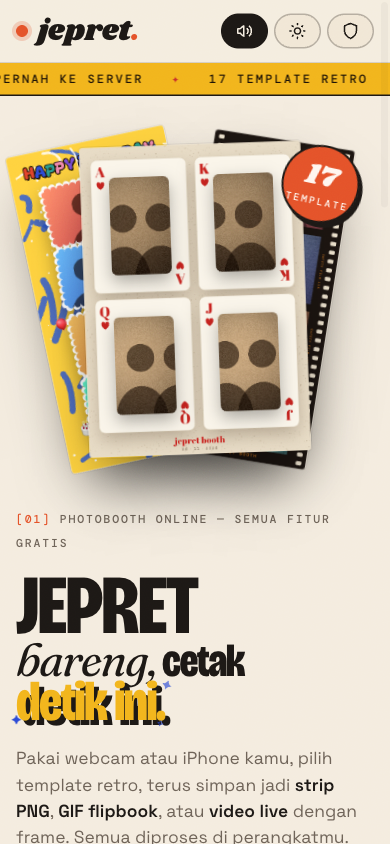

# jepret. — photobooth online



Photobooth di browser: foto pakai kamera atau upload, susun jadi strip, kasih filter/frame/teks/stiker, lalu simpan sebagai PNG, GIF, atau video 9:16. Semua diproses di perangkat, nggak ada backend.

## Jalanin

```bash
npm install
npm run dev        # http://127.0.0.1:5173
npm run build      # hasil statis di dist/, siap upload ke Netlify / Vercel / GitHub Pages
npm run typecheck
```

Kamera cuma jalan di `localhost` atau `https`.

## Fitur

- **Kamera**: Flip cam muter semua kamera yang ada (webcam, iPhone via Continuity Camera di Mac, depan/belakang HP), plus dropdown pilih kamera. Mode **Beruntun** (semua slot sekaligus) atau **Satu-satu** (jepret, review, ulang/lanjut).
- **17 template**: 12 retro (Kartu Remi, Memory Lane, Admit One, Zine, Birthday Bash, Red Room, Pas Foto Studio, Vintage Box, The Jepret Times, Prangko, Film 35mm, Neon Star) + 5 klasik.
- **Bentuk foto**: auto (ikut template), kotak, rounded, oval, bulat, arch, hati, awan, prangko, tiket, die-cut.
- **Export**: PNG ~2400px, GIF flipbook (burst dari klip), video live strip (klip tiap jepretan diputar di dalam template), video "cetak" 9:16.

## Screenshot

| Template | Export (video live + GIF) | HP |
|---|---|---|
|  |  |  |

## Struktur

```
src/
  main.tsx, App.tsx       entry + shell (header, marquee, hero, 3 langkah)
  store.ts                state global (zustand) + actions
  styles.css              semua style, token warna di :root (dark/light)
  lib/
    templates.ts          template: ukuran, slot (posisi/rotasi/bentuk/mat), latar & dekorasi
    render.ts             gambar template + foto + stiker ke canvas
    shapes.ts             path bentuk foto (scallop, prangko, tiket, hati, …)
    paint.ts              helper gambar: frame klasik, teks, grain, sparkle
    filters.ts            filter per piksel (sketsa, film, sepia, mono, …)
    exporters.ts          PNG, GIF (gifenc), video cetak, video live strip
    clip.ts               rekam klip countdown tiap jepretan
    config.ts, types.ts, audio.ts, util.ts
  hooks/useCamera.ts      getUserMedia + daftar kamera
  components/             Header, Hero, Stepper, CaptureStep, DesignStep(+Panels), SaveStep, Overlays
```

Nambah template: tambah satu objek `Template` di `src/lib/templates.ts` (ukuran, slot, `bg`, `decor`) lalu masukin ke array `TEMPLATES`.

## Paket template lokal (opsional)

Taruh file `src/brands/<nama>.ts` buat template khusus (misalnya frame acara kantor atau brand sendiri). Repo ini udah berisi paket **ruparupa** dan **ruparupa Team**. Paket yang nggak boleh publik bisa ditambahin ke `.gitignore` (contohnya `src/brands/azko.ts`); aplikasi tetap jalan normal tanpa file itu. Tiap file meng-export:

```ts
export const group = { id: 'acara', name: 'Acara Kantor', desc: 'frame internal' };
export const templates: Template[] = [/* objek Template, sama kayak di src/lib/templates.ts */];
```

File berawalan `_` (misalnya `_kit.ts`) dianggap helper dan nggak dimuat sebagai paket. Gambar (logo) di-load lewat `registerAsset`, jadi preview dan export nunggu sampai gambarnya siap.

## Kategori berkode (opsional)

Kategori template bisa dikunci pakai kode akses: tambahin `lock: { codes: [{ h: '<hash>' }] }` di `group` paketnya. Hash dibikin pakai `npm run hash-code -- KODE` (opsional tambah tanggal terakhir berlaku, `YYYY-MM-DD`). Pengguna masukin kodenya sekali, atau buka link `?kode=KODE` (cocok buat QR di acara).

Catatan: ini pagar ringan buat web statis, bukan keamanan. Template dan logonya tetap ikut terkirim ke browser.

## Kontribusi

PR dan issue welcome, terutama template baru, filter, dan perbaikan buat browser HP.

1. Fork, terus `npm install && npm run dev`.
2. Jalanin `npm run typecheck` dan `npm run build` sebelum bikin PR.
3. Template baru cukup satu objek di `src/lib/templates.ts`. Sertakan screenshot hasilnya di PR.

## Privasi

Nggak ada backend. Kamera, upload, filter, dan export semuanya jalan di browser. Nggak ada foto yang dikirim ke server mana pun.

## Lisensi

[MIT](LICENSE)
